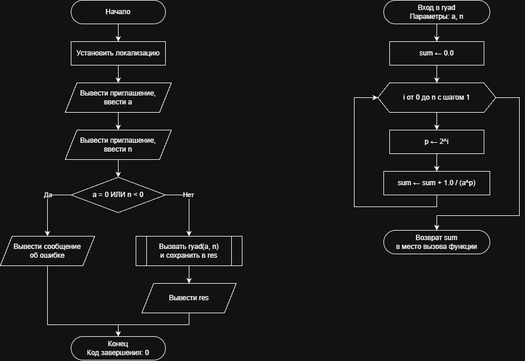

# Домашнее задание к работе 8

## Условие задачи
Вычислите с использованием цикла for значение ряда, для заданных
пользователем значений a и n....
(https://drive.google.com/file/d/1yDJQzTj_fvve6fjmPZY033CgbecCpkjj/view)

## 1. Алгоритм и блок-схема

### Алгоритм
1. **Начало**.
2. Инициализация окружения: установка локализации UTF-8 для корректного вывода символов.
3. Ввод исходных данных с клавиатуры:
   - Ввести вещественное число a ($a \neq 0$)
   - Ввести целое число n ($n \ge 0$)
4. Проверка корректности входных данных:
   - Если a == 0 или n < 0, вывести сообщение об ошибке «Ошибка: некорректные входные данные».
   - Иначе передать значения a, n в функцию ryad, сохранить полученный ответ в переменную res и вывести его на экран с точностью до 6 знаков после запятой.
5. **Конец**.

**Часть 2: Расчетная функция (ryad)**
1. **Начало функции**: получение параметров a, n.
2. Инициализация накопителя суммы: назначить sum = 0.0.
3. Цикл с параметром (для i от 0 до n включительно с шагом 1):
   - Вычислить показатель степени двойки: $p = 2^i$.
   - Прибавить очередное слагаемое ряда к сумме: $sum = sum + \frac{1}{a^p}$.
4. Возврат значения: передать вычисленное значение sum обратно в вызывающую функцию (main) и завершить работу.
5. **Конец**.

### Блок-схема
 

https://github.com/stzraw/lab-8-VSTU-HW/blob/main/lab_8_schema.png

## 2. Реализация программы

```c
#include <stdio.h>
#include <locale.h>
#include <math.h>

double ryad(double a, int n);

int main()
{
    double a, res;
    int n;

    setlocale(LC_ALL, ".UTF8");

    printf("Введите число a (a != 0): ");
    scanf("%lf", &a);
    printf("Введите целое число n (n >= 0): ");
    scanf("%d", &n);

    if (a == 0.0 || n < 0)
    {
        printf("Ошибка: некорректные входные данные\n");
    }
    else
    {
        res = ryad(a, n);
        printf("Сумма ряда: %.6lf\n", res);
    }
    return 0;
}

double ryad(double a, int n)
{
    int i;
    double sum, p;

    sum = 0.0;
    for (i = 0; i <= n; i++)
    {
        p = pow(2.0, i);
        sum += 1.0 / pow(a, p);
    }
    return sum;
}
```

## 3. Результаты работы программы

Введите число a (a != 0): 5
Введите целое число n (n >= 0): 7
Сумма ряда: 0,241603

## 4. Информация о разработчике

Быханов Александр Андреевич бИД - 262 2пг